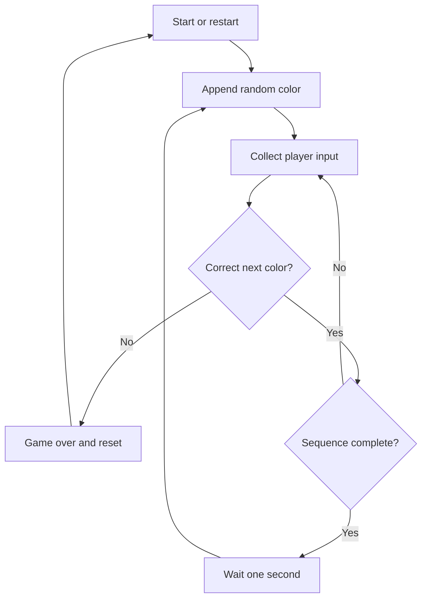

# Simon Game


## Overview

A browser-based memory game inspired by Simon. The player remembers a growing sequence of colored buttons and repeats it in the correct order. The project demonstrates event-driven JavaScript, array-based state management, DOM manipulation and timed feedback.

## Gameplay

1. Press any keyboard key to start.
2. Observe the highlighted button and sound.
3. Repeat the sequence accumulated across rounds.
4. Each correct sequence adds one randomly selected color.
5. An incorrect selection ends the game; press a key to restart.

## Game logic



The game stores the generated sequence and player input in separate arrays. Each click is compared against the corresponding sequence index. Comparison is constant-time per click; sequence storage grows linearly with the level.

The next round is scheduled with setTimeout. Visual classes and audio playback provide feedback for button presses and incorrect answers.

## Structure

| File | Purpose |
|---|---|
| index.html | Four-button game interface |
| styles.css | Game layout and visual states |
| game.js | Sequence generation, input validation and state reset |
| sounds/ | Audio feedback |

## Run locally

```bash
git clone https://github.com/Claudio1009/Simon-Game.git
cd Simon-Game
```

Open index.html in a browser. Internet connectivity is needed for the CDN-hosted jQuery dependency.

## Future improvements

Add touch-friendly start controls, prevent clicks before the game begins or during round transitions, cancel pending timers on reset, improve keyboard accessibility and add deterministic tests for sequence validation.

No browser execution or automated test result is claimed.

## Author

Claudiu Marius Ciupitu — [GitHub](https://github.com/Claudio1009)
